# Adaptive RAG Routing

<p align="center">
  <strong>Intelligent Dynamic Routing Engine for Modular Retrieval-Augmented Generation</strong>
</p>

<p align="center">
  
  
  
  
  
</p>

<p align="center">
  <a href="#system-architecture">Architecture</a> •
  <a href="#mathematical-foundations">Mathematical Foundations</a> •
  <a href="#key-routing-modalities">Routing Modalities</a> •
  <a href="#observability--langsmith-telemetry">Telemetry</a> •
  <a href="#getting-started">Getting Started</a> •
  <a href="#api-reference">API Reference</a>
</p>

---

## Overview

**Adaptive-RAG-Routing** is a high-performance orchestration layer engineered to dynamically route natural language queries to optimal retrieval and reasoning pipelines. At its core, the decision engine is driven by **Aurelio AI's Semantic Router (`IndexedRouter`)** backed by `BAAI/bge-base-en-v1.5` embeddings. Rather than applying a single rigid retrieval strategy or incurring high-latency LLM routing calls, it performs sub-100ms vector space semantic intent routing—fused with lexical density analysis and query decomposition—to dynamically select among specialized RAG modalities:

* **Semantic Decision Router**: Aurelio AI vector-space router evaluating query intent manifolds with calibrated confidence scoring.
* **Hybrid RAG (RRF)**: Fuses dense semantic embeddings (FAISS) and sparse lexical tokens (BM25Okapi) via Reciprocal Rank Fusion ($k = 60$).
* **Corrective RAG (CRAG)**: Self-reflective retrieval with automated confidence scoring, contextual noise stripping, and hallucination guardrails.
* **Standard Dense RAG**: Fast cosine-distance vector indexing backed by Qdrant.
* **Sparse Lexical RAG (VLRAG)**: Pure token-based BM25Okapi search with POS lemmatization for alphanumeric identifiers and error codes.
* **Multi-Query Expansion**: Multi-perspective query generation to overcome lexical mismatch in exploratory prompts.
* **Maximal Marginal Relevance (MMR)**: Re-ranking engine ($\lambda = 0.70$) that penalizes redundant context chunks to maximize prompt entropy.
* **Cache-Augmented Generation (CAG)**: In-memory LRU cache with TTL for zero-latency responses on repeated queries.
* **Direct Generation**: Parametric LLM bypass for greetings, casual chat, and direct mathematical expressions.

---

## Dynamic Architecture & Execution Flow

<p align="center">
  
</p>

1. **Query Ingestion**: Natural language queries enter through the unified `/adaptive_query` endpoint.
2. **Aurelio AI Semantic Routing**: Query embeddings are matched against strategy utterance manifolds using `IndexedRouter` in sub-100ms vector space.
3. **Calibrated Confidence Gating**: Queries scoring above the similarity threshold (0.35) route to their specialized pipeline; low-confidence outliers gracefully default to Cache-Augmented Generation (CAG).
4. **Specialized Retrieval**: Executes the matched modality (Dense Qdrant, Sparse BM25Okapi, Hybrid FAISS+BM25 RRF, CRAG verification, or Multi-Query expansion).
5. **Context Assembly & Generation**: Retained context is synthesized through the parametric LLM engine with anti-hallucination guardrails.

---

## Tech Stack

<p align="center">
  
  
  
  
  
  
  
  
  
  
</p>

---

## Key Routing Modalities

| Modality | Router Module | Mathematical / Algorithmic Core | Primary Triggers & Classification Rule |
| :--- | :--- | :--- | :--- |
| **Semantic Decision Router** | `app/services/semantic_decision_router.py` | Aurelio AI `IndexedRouter` with `BAAI/bge-base-en-v1.5` embeddings | Dynamic intent routing in vector space (sub-100ms inference) |
| **Hybrid RAG (RRF)** | `app/api/routers/hybridrag.py` | Dense vector (FAISS) + Sparse BM25 via Reciprocal Rank Fusion ($k = 60$) | Complex technical queries (>= 6 words), architectural or procedural terms (`"how does"`, `"architecture"`, `"steps"`) |
| **Corrective RAG (CRAG)** | `app/api/routers/crag.py` | Self-reflective dual confidence metric ($\Gamma \ge 0.60$) with sentence noise stripping | Verification and fact-checking queries (`"verify"`, `"is it true"`, `"confirm"`, `"check if"`) |
| **Standard Dense RAG** | `app/api/routers/rag.py` | Cosine similarity vector search via Qdrant in-memory client | Definitions and direct conceptual inquiries (`"define"`, `"what is"`, `"why"`, `"explain"`) |
| **Sparse Lexical RAG** | `app/api/routers/vlrag.py` | BM25Okapi token matching with NLTK POS tagging and WordNet lemmatization | Exact codes, IDs, alphanumeric strings (`_` character, mixed digits/letters, quotes, <= 3 words) |
| **Multi-Query RAG** | `app/api/routers/multirag.py` | Synonym generation & multi-perspective query expansion | Broad, comparative, or multi-faceted queries (`"different"`, `"expand"`, `"perspectives"`, `"compare"`) |
| **MMR Diversity RAG** | `app/api/routers/mmrrag.py` | Maximal Marginal Relevance diversified selection ($\lambda = 0.70$, $K = 5$) | Diversity and taxonomy queries (`"diverse"`, `"variety"`, `"types of"`, `"range of"`) |
| **Cache-Augmented (CAG)** | `app/api/routers/cag.py` | In-memory LRU cache with TTL + semantic key normalization | Repeated inquiries & cached high-frequency states (Default fallback) |
| **Direct Generation** | `app/api/endpoints/query.py` | Zero-retrieval direct parametric LLM generation | Explicit bypass prefix (`"aa"`), conversational greetings, or pure arithmetic |

---

## Mathematical Foundations

### 1. Aurelio AI Semantic Decision Routing
The routing layer leverages **Aurelio AI's `IndexedRouter`** with `BAAI/bge-base-en-v1.5` embeddings to evaluate semantic similarity against route utterances in vector space in sub-100ms:

$$
\mathcal{R}(q) = \arg\max_{r \in \mathcal{S}} \max_{u \in \mathcal{U}_r} \frac{\mathbf{e}(q) \cdot \mathbf{e}(u)}{\|\mathbf{e}(q)\| \|\mathbf{e}(u)\|}
$$

Where:
* $\mathcal{S} = \{\text{CRAG}, \text{Hybrid RRF}, \text{Dense}, \text{Sparse BM25}, \text{MultiQuery}, \text{MMR}, \text{CAG}\}$
* $\mathcal{U}_r$ is the semantic utterance manifold for strategy $r$.
* $\mathbf{e}(\cdot)$ is the normalized dense embedding projection.

If $\max \text{sim} < 0.35$, the query smoothly falls back to Cache-Augmented Generation (CAG). Explicit bot overrides (`strategy="hybrid"`, `strategy="crag"`, etc.) bypass the router directly.

---

### 2. Hybrid RAG: Reciprocal Rank Fusion (RRF)
Dense vector search excels at broad semantic understanding but misses exact alphanumeric identifiers (part numbers, error codes, version flags). Conversely, sparse BM25 matches exact lexical tokens but fails on conceptual paraphrasing. 

To unify both retrieval heads without requiring calibrated probability scores, results are merged via **Reciprocal Rank Fusion**:

$$
\text{Score}_{\text{RRF}}(d \in \mathcal{D}) = \sum_{m \in \{\text{dense}, \text{sparse}\}} \frac{1}{k + r_m(d)}
$$

where:
* $k = 60$ is the smoothing constant that balances high-ranking dominance against lower-ranked consensus.
* $r_m(d) \in \{1, 2, \dots, N\}$ represents the 1-based ordinal rank of document $d$ within retrieval system $m$.
* Documents appearing in both retrieval spaces accumulate score additive bonuses, pushing consensus items to the top of the context window.

---

### 3. Sparse Lexical Scoring: BM25Okapi
For exact identifier and code retrieval, the corpus is tokenized, stripped of non-informative stopwords, and normalized via WordNet POS-lemmatization. Document relevance is scored via the BM25Okapi formula:

$$
\text{Score}_{\text{BM25}}(D, Q) = \sum_{t \in Q} \text{IDF}(t) \cdot \frac{f(t, D) \cdot (k_1 + 1)}{f(t, D) + k_1 \cdot \left(1 - b + b \cdot \frac{|D|}{\text{avgdl}}\right)}
$$

where the Inverse Document Frequency (IDF) is calculated as:

$$
\text{IDF}(t) = \ln \left( \frac{N - n(t) + 0.5}{n(t) + 0.5} + 1 \right)
$$

* $f(t, D)$ is the term frequency of token $t$ in candidate chunk $D$.
* $|D|$ is the length of document $D$ in words, and $\text{avgdl}$ is the average document length across the corpus.
* $k_1 = 1.5$ regulates term saturation non-linearity.
* $b = 0.75$ controls document length normalization.

---

### 4. Maximal Marginal Relevance (MMR)
Standard top-K semantic similarity frequently populates the prompt window with near-duplicate passages. **MMR** maximizes information entropy by balancing candidate query relevance with candidate diversity against already-selected context:

$$
\text{MMR}(Q, \mathcal{D}, \mathcal{S}) \equiv \arg\max_{d_i \in \mathcal{D} \setminus \mathcal{S}} \left[ \lambda \cdot \text{Sim}_1(d_i, Q) - (1 - \lambda) \cdot \max_{d_j \in \mathcal{S}} \text{Sim}_2(d_i, d_j) \right]
$$

where:
* $\text{Sim}_1(d_i, Q) = \mathbf{e}_{d_i}^{\top} \mathbf{e}_Q$ is the cosine similarity between candidate document $d_i$ and query $Q$.
* $\text{Sim}_2(d_i, d_j) = \mathbf{e}_{d_i}^{\top} \mathbf{e}_{d_j}$ measures pairwise semantic similarity between candidate $d_i$ and already selected document $d_j \in \mathcal{S}$.
* $\lambda = 0.70$ provides the optimal trade-off (70% query relevance, 30% novelty diversification).

---

### 5. Corrective RAG (CRAG) Confidence Scoring & Guardrails
When fact-checking or verification queries are received, CRAG acts as an automated validation firewall to eliminate hallucinations. 

The retrieval confidence $\Gamma(q, d, s)$ integrates dense semantic similarity $s$ with query-document keyword overlap:

$$
\Gamma(q, d, s) = 0.70 \cdot \max(0, s) + 0.30 \cdot \left( \frac{|\mathcal{K}(q) \cap \mathcal{W}(d)|}{|\mathcal{K}(q)|} \right)
$$

where $\mathcal{K}(q)$ denotes filtered non-stopword query keywords, and $\mathcal{W}(d)$ denotes the unique vocabulary of document $d$.

The evaluation pipeline branches across three deterministic thresholds:

$$
\text{Action}(\Gamma) = \begin{cases} 
\text{CORRECT}, & \text{if } \Gamma \ge 0.60 \\ 
\text{AMBIGUOUS}, & \text{if } 0.40 \le \Gamma < 0.60 \\ 
\text{INCORRECT}, & \text{if } \Gamma < 0.40 
\end{cases}
$$

* **`CORRECT` ($\Gamma \ge 0.60$)**: High confidence; executes contextual noise stripping to retain the most salient sentence units.
* **`AMBIGUOUS` ($0.40 \le \Gamma < 0.60$)**: Marginal confidence; triggers query reformulation and entity-directed re-retrieval.
* **`INCORRECT` ($\Gamma < 0.40$)**: Low confidence; flags context insufficiency to eliminate hallucinated responses.

---

### 6. Normalized Dense Vector Embeddings
All dense vector embeddings $\mathbf{v} \in \mathbb{R}^D$ are $L_2$-normalized during inference:

$$
\mathbf{e} = \frac{\mathbf{v}}{\|\mathbf{v}\|_2} \implies \|\mathbf{e}\|_2 = 1.0
$$

Under unit-norm constraint, the cosine similarity between query embedding $\mathbf{e}_q$ and document embedding $\mathbf{e}_d$ simplifies to a single matrix dot product:

$$
\text{Sim}_{\cos}(\mathbf{e}_q, \mathbf{e}_d) = \frac{\mathbf{e}_q \cdot \mathbf{e}_d}{\|\mathbf{e}_q\|_2 \|\mathbf{e}_d\|_2} = \mathbf{e}_q^{\top} \mathbf{e}_d
$$

This allows FAISS (`IndexFlatIP`) and Qdrant (`Distance.COSINE`) to execute high-throughput inner product scans with zero runtime vector norm divisions.

---

## Repository Structure

```
Adaptive-RAG-Routing/
├── assets/
│   └── adaptive_rag_animation.svg   # Motion graphics SVG architecture diagram
├── app/
│   ├── api/
│   │   ├── endpoints/
│   │   │   ├── ingest.py            # Unified PDF & text ingestion pipeline
│   │   │   └── query.py             # Adaptive routing classifier & query endpoint
│   │   └── routers/
│   │       ├── hybridrag.py         # Hybrid Dense + Sparse BM25 with RRF (k=60)
│   │       ├── crag.py              # Corrective RAG with self-reflection & noise stripping
│   │       ├── rag.py               # Standard Dense Vector RAG (Qdrant in-memory)
│   │       ├── vlrag.py             # Sparse Lexical BM25 (Vectorless RAG)
│   │       ├── multirag.py          # Multi-Query Expansion RAG
│   │       ├── mmrrag.py            # Maximal Marginal Relevance (Diversity RAG, λ=0.7)
│   │       └── cag.py               # Cache-Augmented Generation (CAG)
│   ├── core/
│   │   ├── config.py                # Configuration and LangSmith environment settings
│   │   ├── embeddings.py            # Normalized text embeddings with resilient fallback
│   │   └── telemetry.py             # LangSmith distributed tracing & @traceable hooks
│   ├── models/
│   │   └── schemas.py               # Pydantic validation schemas (Query, Document)
│   ├── services/
│   │   ├── llm_service.py           # LLM session lifecycle and fallback handler
│   │   └── semantic_decision_router.py # Aurelio AI IndexedRouter with BGE embeddings
│   └── main.py                      # FastAPI application entrypoint & router catalog
├── tests/
│   └── test_routing.py              # Comprehensive classification & integration tests
├── requirements.txt                 # Production dependencies
└── README.md
```

---

## Getting Started

### Prerequisites
* Python 3.10+
* Virtual environment tool (`venv` or `conda`)

### Installation

1. **Clone the repository:**
   ```bash
   git clone https://github.com/prannesshkva/Adaptive-RAG-Routing.git
   cd Adaptive-RAG-Routing
   ```

2. **Initialize virtual environment:**
   ```bash
   python -m venv venv
   source venv/bin/activate  # On Windows: venv\Scripts\activate
   ```

3. **Install dependencies:**
   ```bash
   pip install -r requirements.txt
   ```

4. **Launch the API service:**
   ```bash
   uvicorn app.main:app --host 0.0.0.0 --port 8000 --reload
   ```

5. **Access Interactive Documentation:**
   * Swagger UI: `http://localhost:8000/docs`
   * ReDoc: `http://localhost:8000/redoc`

---

## API Reference

### 1. Ingest Documents

Ingest raw text:
```bash
curl -X POST "http://localhost:8000/ingest/text" \
     -H "Content-Type: application/json" \
     -d '{"text": "FastAPI is a modern, high-performance web framework for building APIs with Python based on standard Python type hints."}'
```

Upload a PDF document:
```bash
curl -X POST "http://localhost:8000/ingest" \
     -F "file=@document.pdf"
```

---

### 2. Query with Automatic Adaptive Routing

```bash
curl -X POST "http://localhost:8000/adaptive_query" \
     -H "Content-Type: application/json" \
     -d '{"message": "how does the FastAPI framework implement modern web APIs with python"}'
```

Response payload includes routing telemetry:
```json
{
  "data": "FastAPI leverages standard Python type hints and Pydantic models to automatically validate request schemas and generate OpenAPI specifications.",
  "routing_strategy": "hybridrag",
  "reason": "Complex or technical query combining concepts and terminology; routed to Hybrid RRF."
}
```

---

### 3. Explicit Strategy Override

You can bypass the classifier and enforce any retrieval strategy directly:
```bash
curl -X POST "http://localhost:8000/adaptive_query" \
     -H "Content-Type: application/json" \
     -d '{
       "message": "verify if FastAPI uses Python type hints",
       "strategy": "crag",
       "explain": true
     }'
```

---

### 4. Telemetry & Observability Inspection

Retrieve live LangSmith tracing metrics, project configuration, and connection status:
```bash
curl -X GET "http://localhost:8000/telemetry"
```

Response payload:
```json
{
  "provider": "LangSmith",
  "library_installed": true,
  "tracing_enabled": true,
  "endpoint": "https://api.smith.langchain.com",
  "project": "adaptive-rag-routing",
  "has_api_key": true
}
```

---

## Observability & LangSmith Telemetry

The routing architecture embeds native **LangSmith `@traceable`** instrumentation across the entire execution tree:

```text
adaptive_query_pipeline (Chain Span)
├── classify_routing_strategy (Chain Span)
│   └── aurelio_semantic_routing (Chain Span)
├── [specialized_rag_retrieval] (Retriever Span)
└── cloud_llm_inference (LLM Span)
```

### Environment Configuration
Configure LangSmith tracing in your `.env` or system environment:

```bash
# Enable LangSmith Distributed Tracing
export LANGSMITH_TRACING=true
export LANGSMITH_ENDPOINT="https://api.smith.langchain.com"
export LANGSMITH_PROJECT="adaptive-rag-routing"
export LANGSMITH_API_KEY="lsv2_pt_..."

# Legacy LangChain environment compatibility (also supported automatically)
export LANGCHAIN_TRACING_V2=true
export LANGCHAIN_ENDPOINT="https://api.smith.langchain.com"
export LANGCHAIN_PROJECT="adaptive-rag-routing"
export LANGCHAIN_API_KEY="lsv2_pt_..."
```

* **Zero-Overhead Local Fallback**: When `LANGSMITH_API_KEY` is not supplied, `@traceable` operates in local execution mode without breaking test suites or API calls.
* **Granular Spans**: Every retrieval pass, vector-space routing decision, and LLM generation emits nested spans with latency profiling and token metrics.

### Groq LLM Engine with `wrap_openai` Telemetry
For ultra-fast response generation and native token accounting in LangSmith, configure your Groq API credentials:

```bash
# Groq LLM Provider & Target Model
export GROQ_API_KEY="gsk_..."
export GROQ_BASE_URL="https://api.groq.com/openai/v1"
export GROQ_DEFAULT_MODEL="openai/gpt-oss-120b"
```

The service leverages LangSmith's official client wrapper (`from langsmith.wrappers import wrap_openai`) over `openai.AsyncOpenAI`:
* **Native Token Accounting**: Automatically tracks exact prompt tokens, completion tokens, model parameters, and generation latency in LangSmith.
* **Model Endpoint**: Connects to `openai/gpt-oss-120b` via `https://api.groq.com/openai/v1`.
* **Resilient Fallback**: If `GROQ_API_KEY` is not configured or encounters network limits, the service smoothly falls back to the secondary cloud generation engine.

---

## Testing

Execute the comprehensive test suite to verify routing classification, FAISS/BM25 indexing, LangSmith telemetry hooks, and CRAG threshold gating:

```bash
python tests/test_routing.py
```

Expected output:
```text
--- Testing LangSmith Telemetry & Traceable Decorators ---
[PASS] LangSmith OS environment variables correctly configured.
[PASS] Telemetry status verified: {'provider': 'LangSmith', 'library_installed': True, 'tracing_enabled': True, 'endpoint': 'https://api.smith.langchain.com', 'project': 'adaptive-rag-routing', 'has_api_key': False}
[PASS] Traceable function execution succeeded.
All LangSmith telemetry tests passed successfully!

--- Testing Aurelio AI Adaptive Routing Classification ---
[PASS] 'verify if quantum encryption has mathematical proo...' -> Expected: crag, Got: crag (conf: 0.644)
[PASS] 'is it true that light speed is constant...' -> Expected: crag, Got: crag (conf: 0.59)
[PASS] 'ERR_404_NOT_FOUND...' -> Expected: vlrag, Got: vlrag (conf: 0.99)
[PASS] 'how does the transformer attention mechanism work ...' -> Expected: hybridrag, Got: hybridrag (conf: 0.741)
[PASS] 'what is the definition of entropy...' -> Expected: rag, Got: rag (conf: 0.795)
All Aurelio AI classification tests passed successfully!

--- Testing Document Ingestion & Routing End-to-End ---
[PASS] CRAG correctly detected out-of-domain query and prevented hallucination!
All end-to-end integration tests passed successfully!
```

---

## Author & Attribution

* **Architect**: [Prannessh KVA](https://github.com/prannesshkva)
* **Profile**: [github.com/prannesshkva](https://github.com/prannesshkva)
* **Focus**: Non-Euclidean SSMs, Differentiable Agentic Systems, and Modular RAG Architectures

---

## License

This project is licensed under the MIT License.
